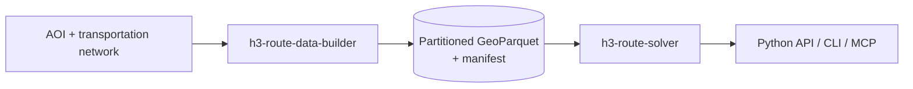

# H3 Route Solver

<!--start-->
[](LICENSE)


An **ArcPy-free** Python library, CLI, and [MCP](https://modelcontextprotocol.io/) server for fast
origin-destination (OD) and proximity queries between arbitrary coordinates or
[H3](https://h3geo.org/) cells, using the sparse precomputed network cost dataset published by
[h3-route-data-builder](https://github.com/knu2xs/h3-route-data-builder).

Give it two locations and it finds the nearest cells that were actually solved on the network,
looks up the precomputed network cost between them, and returns the answer **in separate
parts**: the estimated off-network "stretch" at each end, plus the real network cost in between.
Nothing estimated is ever disguised as a solved network cost.

## How It Fits Together

This is one of two projects that share a single data contract:

| Project | Role | ArcPy? |
|---|---|---|
| [h3-route-data-builder](https://github.com/knu2xs/h3-route-data-builder) | Builds and publishes the sparse OD dataset | Yes |
| **h3-route-solver** (this repo) | Pip-installable library, CLI, and MCP server that queries the dataset | No |



## Key Concepts

- **Solvable cell** - an H3 cell (resolution 10 by default) whose polygon intersects the
  network. Only solvable cells have precomputed OD costs.
- **Endpoint resolution** - any input coordinate or H3 cell is normalized to the dataset's
  resolution. If it is not solvable, the solver searches outward ring by ring (bounded by
  `max_k`, `max_stretch_distance_m`, or `max_stretch_time_s`) for nearby solvable cells.
- **Separated cost components** - every answer reports origin stretch, network cost, and
  destination stretch separately. Combined totals are provided only when they can be added
  honestly, and stretch values are always labeled as estimates:

    ```text
    estimated_stretch_distance_m = grid_k * center_spacing_factor * average_edge_length_m
    combined_distance_m = origin_stretch_distance_m + network_distance_m + destination_stretch_distance_m
    ```

- **Endpoint-selection policies** - `nearest_grid`, `nearest_metric`, and
  `minimum_combined_cost` (bounded multi-candidate search).
- **Explicit non-answers** - responses distinguish `invalid_input`,
  `no_solvable_cell_within_cutoff`, `not_built`, `unreachable`, `outside_network_cutoff`, and
  `dataset_error`. Missing OD rows are never replaced with straight-line distance.

See [System Architecture](docsrc/mkdocs/design/02-system-architecture.md) and
[Data Contract](docsrc/mkdocs/design/03-data-contract.md) for details.

## Installation

The solver does not require ArcGIS or ArcPy.

```
pip install git+https://github.com/knu2xs/h3-route-solver.git
```

Optional extras:

| Extra | Adds |
|---|---|
| `mcp` | MCP server for LLM agents |
| `geo` | GeoPandas output |
| `dev` | Testing and formatting tools |

```
pip install "h3-route-solver[mcp,geo] @ git+https://github.com/knu2xs/h3-route-solver.git"
```

## Planned API

> Nothing below is implemented yet. It previews the surface defined in the feature specs.

| Python | CLI | MCP tool | Purpose |
|---|---|---|---|
| `resolve_location` | `resolve` | `resolve_location` | Map a coordinate or H3 cell to solvable endpoint cell(s) |
| `od_cost` | `lookup` | `get_od_cost` | Network + stretch cost between two locations |
| `nearest` | `nearest` | `find_nearest` | Nearest destinations by network cost |
| `reachable` | `reachable` | `get_reachable_h3_cells` | Solvable cells reachable within a cutoff |
| `matrix` | - | `get_od_matrix` | Bounded OD matrix |
| - | `describe`, `validate` | `describe_dataset` | Dataset manifest and validation |

Feature specs:
[001 Dataset catalog and resolution](docsrc/mkdocs/design/solver/001-dataset-catalog-and-resolution.md),
[002 OD and proximity API](docsrc/mkdocs/design/solver/002-od-and-proximity-api.md),
[003 MCP server](docsrc/mkdocs/design/solver/003-mcp-server.md),
[004 Performance and deployment](docsrc/mkdocs/design/solver/004-performance-and-deployment.md).

## Getting Started (Development)

1. Clone this repo.

    ```
    git clone https://github.com/knu2xs/h3-route-solver.git
    cd h3-route-solver
    ```

2. Create the environment with `make env`, or use a plain virtual environment:

    ```
    python -m venv .venv
    .venv\Scripts\activate
    pip install -e ".[mcp,geo,dev]"
    ```

3. Run the tests.

    ```
    make test
    ```

## Status and Roadmap

**Pre-alpha / specification phase.** No solver code exists yet. Solver work follows phases 5-7
of the [roadmap](docsrc/mkdocs/design/10-roadmap.md):

5. **Stretch resolver** - bounded H3 expansion, distance/time-to-`k`, ties, provenance.
6. **Sparse API** - OD, nearest, reachable, and matrix with separate cost components.
7. **MCP** - strict tools, limits, packaging, and contract tests.

Open questions to settle with `/speckit-clarify` include the default endpoint-selection policy,
approximate versus exact centroid distance, default access speed, per-endpoint versus combined
stretch limits, and maximum `k`/candidate counts.

## Development Workflow

Development is spec-driven with [Spec Kit](https://github.com/github/spec-kit) and GitHub Copilot.

- The project constitution lives in [.specify/memory/constitution.md](.specify/memory/constitution.md).
  Every plan is checked against it.
- Coding conventions for AI assistants and humans are in [AGENTS.md](AGENTS.md).
- Feature workflow in Copilot Chat:
  `/speckit-specify` -> `/speckit-clarify` -> `/speckit-plan` -> `/speckit-tasks` ->
  `/speckit-analyze` -> `/speckit-implement`.
- The first feature to specify is the **dataset catalog and endpoint resolution** (roadmap
  phase 5), using
  [001 Dataset catalog and resolution](docsrc/mkdocs/design/solver/001-dataset-catalog-and-resolution.md)
  as input.
<!--end-->

<p><small>Project based on the <a target="_blank" href="https://github.com/esri/cookiecutter-spatial-data-science">cookiecutter
spatial data science project template</a>. #cookiecutterdatascience</small></p>
